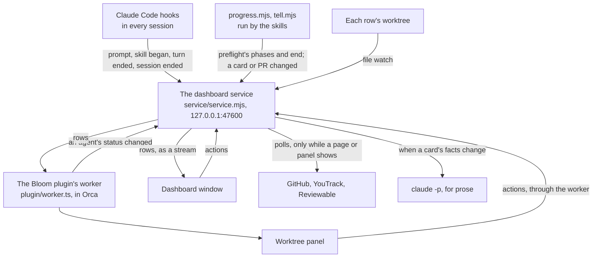
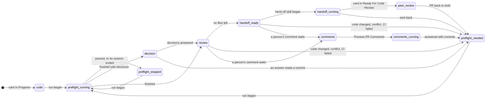
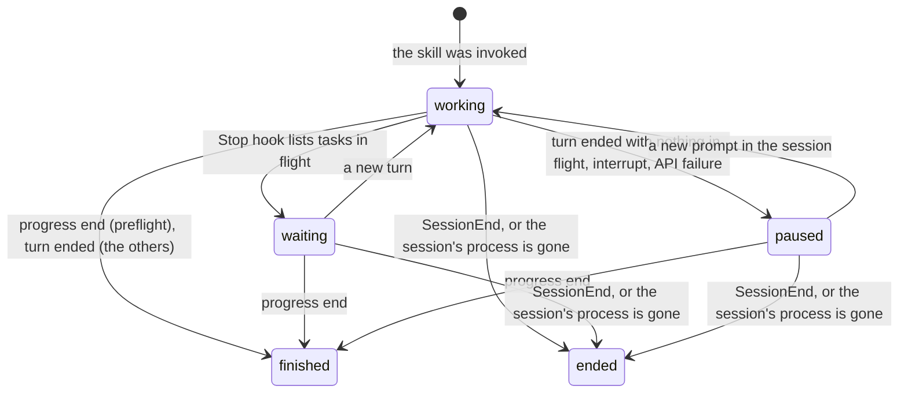

# How the dashboard works

One process on each developer's machine, the dashboard service, holds every fact, computes every
row and does what every button asks. The dashboard page and Orca's Worktree panel draw what it
computed. `SKILL.md` covers showing and installing it; this file is for a developer or an agent
changing this folder's code.



## Who decides what

| File | Decides |
| --- | --- |
| `service/rows.mjs` | a card's state in the process, the Process column's steps, which buttons are enabled and why, the group, the "Why?" (`stateOf`, `computeRow`, `allowAction`). The only place with these rules |
| `service/runs.mjs` | the sessions and the runs of the process skills in them, from hooks, progress records and Orca |
| `service/service.mjs` | when each source is read, the HTTP endpoints, the actions, restarting onto changed code |
| `service/git.mjs`, `gather.mjs`, `own-review.mjs`, `pr-comments.mjs` | reading git, YouTrack and GitHub, the developer's review marks, the comments that wait |
| `service/prose.mjs` | the three pieces of prose that a model writes |
| `service/deciders.mjs` | the decider forms that wait for answers |
| `row.js`, `dashboard.css` | drawing a row. The page and the panel both load them, and they hold no rule |
| `plugin/` | Orca's side: `worker.ts` relays, `panel-facts.mjs` reads what only Orca knows, `panel.js` draws |

`rows.mjs` and `runs.mjs` are plain functions of their arguments, tested in `service/*.test.mjs`.

## Where each fact comes from

| Fact | From | How | When |
| --- | --- | --- | --- |
| A session's prompt began (the "working for 12 min" clock) | `UserPromptSubmit` hook | pushed | each prompt |
| A session began a process skill | `UserPromptExpansion` (typed `/preflight`), `PreToolUse` on `Skill` (the model called it), or `progress.mjs start` | pushed | each start |
| A turn ended, and what is still in flight | `Stop` hook (`background_tasks`, `session_crons`), `StopFailure` | pushed | each turn |
| A session ended | `SessionEnd` hook; or its process is gone | pushed; checked every 15 s in the service's own process | |
| Preflight's phases, and its end with the commit and tree | `progress.mjs` (a file in `progress/`, then a nudge) | pushed | each step |
| An agent is working, asks a question, was interrupted | Orca: the plugin pushes `agent.status.changed`, then one `orca worktree ps` | pushed | each change; every 5 min as a check; every 5 s while visible with no plugin connected |
| HEAD, tree, uncommitted files, ahead and behind | git | file watch on the worktree's git folder; after a tool call in a session there | each change; every 60 s while visible |
| Cards, PRs (draft, mergeable, CI, report), worktrees | `gather.mjs --core` | polled | every 60 s while visible; at once on Refresh, on `tell.mjs`, on becoming visible |
| History, "Back with you for review", worktrees of resolved cards | `gather.mjs` | polled | every 15 min while visible; Refresh |
| The developer's review marks; comments waiting | GitHub and Reviewable, one request at a time | polled | every 60 s while visible for a PR whose step depends on it, otherwise every 5 min; at once when the window gains focus |
| Prose | `claude -p` | computed | when the facts it describes have changed and stayed so for 2 min |
| To-do items | the developer | `tasks.json` | the one file that nothing can work out again |

"Visible" means a dashboard page whose window shows, or a Worktree panel that asked in the last 45
seconds. With nothing visible and no skill running, the service starts no process.

A source whose last read failed keeps its last good value, and the row says so ("GitHub could not
be read; showing what it said 12 min ago"). A fact that could not be read is never shown as a
default: git that cannot be read makes Preflight the next step with "cannot tell whether the code
changed", and a review that cannot be read offers the review and Request Peer Review together.

## A card's state

`stateOf` in `service/rows.mjs` runs these rules in order; the first that matches decides.

| State | When | On offer |
| --- | --- | --- |
| `peer-review` | the card is in Ready For Code Review | Process PR Comments when comments wait |
| `preflight-running`, `comments-running`, `handoff-running` | a run of that skill is working or waiting in the worktree | nothing |
| `no-worktree` | no worktree and no PR | create a worktree |
| `comments` | an unresolved discussion ends with a person's comment | Process PR Comments; the review stays offered |
| `code` | no PR and no preflight run | Code; Preflight too once the worktree holds commits or changes |
| `preflight-stopped` | the last preflight run paused or ended before finishing | Preflight |
| `preflight-needed` | no finished run, or the tree differs from the one it ended on, or tracked files are changed, or the PR conflicts, or CI fails | Preflight, with the reason under it |
| `decision` | the finished run's report lists decisions and the code has not moved | the report |
| `review` | preflight is valid and files are left to review | the PR in Reviewable |
| `handoff-ready` | nothing is left | Request Peer Review, and Merge without Peer Review with the "Approved Plan" tag |



Preflight is valid when a run finished, the worktree's tree is the one that run ended on (so a
squash or rebase that keeps the content changes nothing), no tracked file is changed, the PR does
not conflict and CI has not failed. Nothing stores "the next step": it is computed from these each
time a fact changes.

A working agent, or a question in its terminal, is drawn over the state: a working agent shows on
the step of the run that is open in its worktree, or on Code when none is, and either one disables
the row's buttons. `allowAction` gives each button its enabled state, and the service runs it again
on what Orca says at that moment before it acts, so a button and its action cannot disagree.

## A run's state

A run is one invocation of `preflight`, `request-peer-review`, `merge-without-peer-review` or the
Process PR Comments prompt in one session (`service/runs.mjs`).



- No state comes from the text of a prompt, apart from the Process PR Comments prompt, which the
  dashboard itself types.
- Claude Code runs no `Stop` hook when the developer interrupts a turn, so an interrupt comes from
  Orca (`mainAgent.outcome` of `interruption`).
- The `SessionStart` hook is a command (`service/hook-session.mjs`) so that it can send the
  session's process id, which the HTTP hooks cannot carry. A session that began before the hooks
  were installed has none; it ends when Orca shows no agent in its worktree.
- A phase that preflight never reported has no state on the stepper. Nothing but the stepper
  depends on phase reports.

## The buttons

A click posts `{ action, path or card }` to `/action`. For a skill, the service asks Orca for the
agents in the worktree, checks `allowAction`, types the skill into the session
(`../orca-worktrees.mjs`), and marks the step "Starting…". The hook that reports the run beginning
confirms it. When none arrives within 30 seconds, the row says "Typed Preflight at 14:02, but the
session did not start it" for ten minutes. A refused action shows its reason beside the page's top
note; a disabled button's tooltip gives the same reason beforehand.

The panel's buttons go to the session the panel shows (`paneKey`); a session that has closed is an
error, never another session.

## The service's life

- **Install**: `service/install.mjs` merges the hooks into `~/.claude/settings.json` (keeping a
  copy as `settings.before-hooks.json`), starts the service when Orca is running, and loads the
  Orca plugin. Run again, it replaces what it made.
- **With Orca**: the plugin's worker starts the service whenever it does not answer, and nothing
  starts it at login. Each of the worker's requests for the state names Orca's process, and every
  15 seconds the service checks that the process is alive. With no process named, or once it is
  gone, the service reads the process list (at most once a minute) and exits when no Orca app is
  in it, first telling the open pages to close their windows. `service/start.mjs` starts nothing while Orca is not running.
- **One at a time**: the port is the lock. A second service finds it taken and exits.
- **Its environment**: `service/env.mjs` builds it from the registry whoever started the service,
  since Orca starts processes without the user's Path and tokens.
- **Changed code**: the service watches this checkout. A changed `.mjs` file restarts it onto the
  new code, after `service.mjs --check-only` shows that the code loads; when it does not load, the
  service keeps running and the indicator says so. A changed page file reloads the open pages, and
  a changed plugin file has Orca reload the plugin. This is how a daily pull takes effect.
- **Killed**: the Orca plugin starts it again after three failed requests. Run records are on
  disk, and the first check after a start ends the runs whose sessions have gone.
- **The Service indicator** in the page's top bar is green when every source answered its last
  read, amber when one did not or new code does not load, red when the page has lost the service.
  Pressing it lists each source with the age of its last read, the branch, commit and folder of
  the code that runs, hook and plugin traffic, the prose model with today's calls and tokens, and
  Restart service.

Its files in `~/.claude/bloom-dashboard/` are listed at the top of `service/env.mjs`.

## Prose

A model writes three things and nothing else: one sentence on where the work has got to, on a card
in Has Comments what the reviewers asked for, and a "Next:" note for something outside the normal
process. The page shows what the service computed until the prose arrives, dims prose that is
older than the facts, and drops a "Next:" that only names a step of the process.

The model is `claude-haiku-5-5`, through `claude -p`, which uses the developer's own sign-in. The
job is to put a dozen given facts into a sentence, so the smallest model does it; a call takes
about five seconds and costs about a quarter of a cent. `config.json` in the data folder changes
it: `{ "model": "claude-sonnet-5-5" }`, or `{ "prose": false }` for none.

## Deciders

`decider/claude-decider.mjs` hands its form to the service and waits. The service serves the form
at `/decide/<id>`, lists it under "Waiting for your answers" and on its card's row as "Needs your
decision", and gives the answers to the waiting process, which prints them for its session. Forms
are files, so one that waits through a restart of the service is still answered. With no service
running, the decider serves its form itself.

## The Orca plugin

`orca-plugin.json` with `plugin/` is one plugin: the Bloom Dashboard button in the status bar,
which also says how many cards wait for the developer, and the Worktree panel. The plugin's folder
is this whole folder because Orca lets a panel load only files inside its plugin's folder, and the
panel loads `row.js` and `dashboard.css`. `orca-plugins.mjs` loads it.

## Tests

```sh
node --test "*.test.mjs" "dashboard/**/*.test.mjs"
```

from the clone's root; CI runs the same (`.github/workflows/test.yml`).
